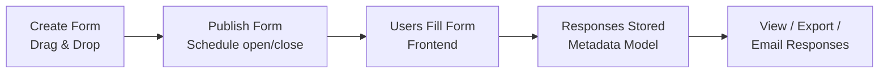

# Feature: Dynamic Form Builder

## What It Is
A drag-and-drop tool that lets an Admin or Club Lead **create any form** — event registration, hackathon sign-up, feedback survey, membership application — without writing code, and without a developer creating a new database table for it.

## Why It Exists
Every module on the platform (Events, Hackathons, Career, Membership) needs its own registration/application form, and those forms are never identical — a workshop might need just name + email, while a hackathon needs team details, track selection, and file uploads. Building each of these as custom code would be slow and would require a developer for every new form. The Dynamic Form Builder makes form creation a **content task**, not a **development task**. The technical trick that makes this possible — storing forms as data instead of database tables — is explained in [../architecture/data-model-dynamic-forms.md](../architecture/data-model-dynamic-forms.md).

## How It Works (Admin Side)

1. **Create** — Admin opens the form builder, drags in fields (see supported types below), sets labels, marks fields required/optional, adds validation rules.
2. **Configure Policies** — In Forms Registry:
   - **Submission Limits**: Choose whether students can submit multiple times or are restricted to 1 response per student.
   - **Response Editing**: Allow students to revisit the form and update their previously submitted answers.
   - **Auto-fill Student Profile**: When the limit is 1, enable automated profile matching (matching verified student Name, Email, Phone, Roll Number, Branch, Year, GitHub, and LinkedIn).
3. **Publish** — Admin schedules when the form opens/closes (or publishes immediately). See [scheduling.md](scheduling.md).
4. **Fill & Auto-match** — Authenticated members see their profile details pre-filled and submit the form.
5. **Store & Persist** — Every submission is saved as a "Response," with each answer linked to its field in PostgreSQL.
6. **View/Export/Email** — Admin can view responses in a table, export to CSV/Excel (see [data-export.md](data-export.md)), or trigger emails to everyone who responded (see [email-notifications.md](email-notifications.md)).

## Automation (Club ID + Confirmation Email)

Every form has an **Automation** section (in the builder, right under the title/description card) with two independent toggles:

- **Generate Club Member ID on submission** — pick which of this form's own fields
  supplies the submitter's email (required) and, optionally, name/phone/branch/roll
  number, plus a 2–6 letter Club ID prefix (default `SCC`). On each completed
  submission, the person is matched by that email against the club member
  directory: a new email gets a fresh, permanent, sequential Club ID (e.g.
  `26SCC001`); an email that's submitted before — on this form or any other
  Club-ID-enabled form — keeps the ID it already has. Safe under concurrent
  submissions: allocation is a row-locked counter, so two people finishing at the
  same instant can never receive the same ID. See
  [../architecture/data-model-dynamic-forms.md](../architecture/data-model-dynamic-forms.md#submission-time-automation-club-id--confirmation-email)
  for the technical detail.
- **Send confirmation email on submission** — pick an existing
  [Email Template](email-notifications.md) or draft a new one inline (subject,
  body, and which `{{placeholders}}` like `{{full_name}}`/`{{club_id}}` to use).
  The submitter receives it, personalized with their own answers, once their
  response is saved.
- **Verify Club ID on submission** — alternatively, add the dedicated **Club ID**
  field from the builder palette. A Club ID field automatically verifies the
  submitted value against the member directory before the response is saved,
  using case-insensitive, trimmed matching. An unregistered ID is rejected;
  optional mapped profile fields can also be checked against the member record.
  The legacy Automation toggle and field mapping remain supported for existing
  forms, and a form cannot generate and verify IDs at the same time.

Field mapping needs a field's **permanent** ID, so a brand-new form must be saved
once before its fields can be mapped — the builder shows a hint and hides the
mapping controls until then.

## Supported Field Types
Text · Email · Phone · Number · Club ID · Dropdown · Radio Button · Checkbox · Date · Time · File Upload · Multi File Upload · Paragraph · URL · Section (visual grouping) · Page Break (starts a new page) · Rating · Linear Scale · Matrix · Signature · Conditional Logic (show/hide/require a field based on a previous answer)
nFile questions can send files straight to cloud storage with a per-question size limit (default 2 MB); see [form-file-uploads.md](form-file-uploads.md).

## Validation & Rules (backend-enforced)

Every rule an admin configures is validated **twice**: once when the form is
published (a form with an invalid definition — bad regex, `minLength > maxLength`,
a choice field with no options, a conditional rule pointing at a deleted field —
**cannot be published**), and again on **every submission**, server-side,
regardless of what the browser checked.

- **Per-type response validation** — alphabetic/alphanumeric/numeric/email/phone/
  URL/date formats, min/max/exact length, min/max value, regex, allowed
  characters, starts/ends/contains, min/max selections, date ranges, file
  type/size/count, rating range, matrix rows/columns.
- **Conditional logic** — nested `AND`/`OR` groups, ~30 operators (equality,
  numeric, text, selection, date), and actions `show` / `hide` / `require` /
  `optional`. A field hidden by its condition is **not required** and any stray
  answer for it is discarded.
- **Cross-field rules** — compare one answer to another (confirm-password,
  `Start Date <= End Date`, `Min Salary <= Max Salary`, "Company required if
  Employment Status = Employed").
- **Security** — the API rejects answers for unknown / other-form / deleted
  fields, duplicate answers, wrong data types and attempts to bypass required or
  conditional rules. The stored definition is the source of truth.

Admin tools (**Manual Entry**, **CSV Import**, **Backup Import**) run the same
engine in *partial mode*: structural / type / option errors still block, but
missing-required and constraint misses are recorded as warnings so incomplete
legacy data can still be captured (`?force=true` overrides even hard errors on
Manual Entry, and is audit-logged).

Full rule reference: [`../reference/form-validation-rules.md`](../reference/form-validation-rules.md).
Architecture: [`../architecture/form-validation-engine.md`](../architecture/form-validation-engine.md).

## Per-Question Controls

Open "Response validation" on a question for these, next to its rules:

- **Your own error messages** for each way it can fail (left empty, not a valid value, each rule you set, already used, option full).
- **Each answer only once** (TEXT, EMAIL, PHONE, NUMBER, URL): the same answer, ignoring case, cannot be given twice.
- **Places per option** (RADIO, DROPDOWN, CHECKBOX): a full option disappears from the form ("Places left: Morning (3 left)" shows
  when ten or fewer remain) and the server refuses it. The form page reads `GET /api/forms/{slug}/availability/`.
- **Default answer** pre-filled on the form.
- **Comparisons with other questions**, as many as you like, each with its own message.

Two extra question types: **Hidden Field** (records a value from the link, e.g. `?ref=poster`, or a default; the respondent never
sees it) and **Calculated** (a read-only total worked out from number questions with `+ - * /`; recomputed by the server on submit).

**Answer piping.** `{{12}}` in any question label, help text, section or page title or note is replaced on the form by what the
person answered to question 12 ("Hello {{12}}!"), and shows `...` until they have. Use "Insert an earlier answer" in a question's
footer to add the token; it only lists questions that are saved and above this one.

## Multi-Page Forms

A **Page Break** question splits a form into pages. The break heads the page it starts: its label is that page's
title and its description a short introduction (page 1 has no break). Page breaks are structure only: never
answered, never required, no validation rules.

- **Public form.** One page at a time, with "Page X of Y" and a progress bar, Back and Next, and Submit on the last
  page. Leaving a page checks the questions on it; Submit checks the whole form and jumps to the page of the first
  problem, including problems the server reports.
- **Routing.** A page break can carry a condition with an action, deciding what follows the page *before* it:
  `skip_to_section` (`action_value` = the id of a **later** page break) jumps ahead, `end_form` ends the form there.
  Pages that are skipped are hidden: nothing on them is asked, required or kept, and their answers no longer feed other
  conditions. A routing rule can only watch questions on earlier pages. The server applies the same routes on
  submit, so a client cannot answer pages it should not have seen.
- **Builder.** "Page routing" on a page break uses the same rule editor as conditions. Page breaks must be saved before
  another break can target them (they need real ids), and publishing refuses a route whose target is not a later page
  break. An empty page (two breaks in a row, a break at the very top or bottom) is a warning.

## Autosave

Signed-in people can leave a form and come back: their answers and page are saved to the server a moment after
each change (`ResponseDraft`, one per form and user) and offered again on return, from any device. Files and
signatures are never saved, since they are too big to rewrite every few seconds; the respondent attaches them again.

| Endpoint | |
|---|---|
| `GET /api/forms/{slug}/draft/` | `{"draft": {answers, current_page, updated_at, form_changed} \| null}`; answers for questions removed since are left out, and `form_changed` says the form was edited after the draft was saved |
| `PUT /api/forms/{slug}/draft/` | body `{answers: {"<question id>": value}, current_page}`; every answer must be something its question could hold (same size and character limits as a submission) or it is dropped and listed in `dropped`; `409 FORM_NOT_OPEN` when the form is closed, scheduled for later or a draft; `413` above 200 KB; limited to 90 saves a minute |
| `DELETE /api/forms/{slug}/draft/` | discards it |

A draft is deleted when its respondent submits, ignored after 30 days, and removed by
`python manage.py purge_form_drafts`, or the Run now button on Admin -> Maintenance. Editing an already-submitted response does not use drafts.

## Editing a Form Safely

- **Help text.** Each question has a `description` (shown under its label on the public form). It is stored on `FormField.description`.
- **All-or-nothing saves.** Saving a form (title, settings and every question) runs in one database transaction, so a failure part-way leaves the previous version untouched.
- **Answered questions keep their type.** Once a question has responses, changing its type is refused (`FIELD_TYPE_LOCKED`, HTTP 400, listing the offending questions); the label, help text, options and rules can still change. Add a new question instead.
- **Deleting a question.** `DELETE /api/forms/{slug}/fields/{id}/` first answers with a warning listing everything that points at the question: other questions' conditional rules (including nested groups and the legacy `if` shape), cross-field rules, and the Club ID field mapping (`form_settings`). Repeating the call with `?confirm=true` removes those references too, so no dead rule is left behind, then soft-deletes the question. Removing one rule from a group keeps the rest of the group and its action.

## Version History, Copies and Templates

- **Versions.** Every create, update, publish and restore stores a snapshot of the form definition (settings and questions, not responses) as a `FormVersion` (`apps/forms/versions.py`). The newest 50 are kept. `GET /api/forms/{slug}/versions/` lists them; `GET /api/forms/{slug}/versions/{n}/?against=current|{m}` shows what changed against the previous version, the current form, or another version.
- **Restore.** `POST /api/forms/{slug}/versions/{n}/restore/` puts an old definition back as a new version (nothing is lost). It is refused with the usual field errors when it would break answered questions (for example a type change on a question that has responses).
- **Review before saving a live form.** The builder first calls `POST /api/forms/{slug}/preview-changes/` (nothing is saved) and, for a published or scheduled form, shows the diff plus an impact list: new required questions, questions that become required, removed questions with answers, removed options that responses chose, and blocked type changes. Saving continues only after the admin confirms. If the preview itself fails, the save still goes ahead and reports its own errors.
- **Duplicate.** `POST /api/forms/{slug}/duplicate/` creates a draft copy with a unique slug; question ids inside conditions, formulas, piping and Club ID mappings are remapped to the copy (`definition_io.remap_references`).
- **Templates.** `POST /api/forms/{slug}/save-as-template/` stores a copy with `is_template=true`. Templates are left out of the normal list; admins see them with `GET /api/forms/?templates=only` and start a new form from one with the duplicate action.
- **Export / import.** `GET /api/forms/{slug}/export-definition/` downloads a JSON file (format `srkrcc-form`, version 1); `POST /api/forms/import-definition/` creates a draft from one (max 1 MB, validated like any other save).

## After Submitting, Bot Protection and Analytics

- **Thank-you page.** `confirmation_message` (up to 2000 characters) replaces the default text on the page shown after submitting; `{{12}}` is replaced by the answer to question 12 in the browser. `redirect_url` (an `https://` address or a path such as `/events`; anything else is refused with HTTP 400) and `redirect_delay_seconds` (0-30, default 5) send the respondent onward after a countdown they can skip or cancel. The public form re-checks the address before navigating. All three are form settings, so they appear in version history and are copied by duplicate / templates / export.
- **Bot protection** (`apps/forms/spam.py`). Every public form carries a hidden honeypot input (`hp_q7z4`, a name browsers and password managers do not recognise, so a real person is never mistaken for a bot); a submission that fills it is answered with a normal-looking `201` and dropped. With `captcha_enabled` the respondent must also pass Cloudflare Turnstile: the browser sends `captcha_token`, the server verifies it (`TURNSTILE_SECRET_KEY`; the website needs `NEXT_PUBLIC_TURNSTILE_SITE_KEY`). Failure codes: `CAPTCHA_MISSING` / `CAPTCHA_FAILED` (400), `CAPTCHA_UNAVAILABLE` / `CAPTCHA_NOT_CONFIGURED` (503). Staff are not asked. A form with the check on cannot go live while the secret is missing (`CAPTCHA_NOT_CONFIGURED`, HTTP 400) by any route - the publish button, saving a form as published, switching the check on for a live form, or re-opening a closed one - and refuses submissions rather than skipping the check. Editing an existing response is not re-checked.
- **Analytics** (`apps/forms/analytics.py`). `GET /api/forms/{slug}/analytics/?days=30` (1-365) returns the response total, a per-day timeline, for each question how many answered and the shape of the answers (option counts, number range and average, most repeated text), and where unfinished responses stopped (taken from the saved server-side drafts). Test submissions are excluded; only the newest 5000 responses and 5000 unfinished drafts are scanned (`truncated` says so for responses). Days are counted in the server's local time zone (Asia/Kolkata).
- **Admin UI.** The form builder has *After submitting* settings (message, redirect, bot check) and an *Analytics* button for a saved form.

## Language and Accessibility

- **Form language.** `Form.language` (`en`, `te` or `hi`; default `en`; anything else is refused with HTTP 400) sets the language of the words the form itself speaks to a respondent: the Back / Next / Submit / Update buttons, "Page 1 of 3", draft-saved notices, the sign-in and "already submitted" prompts, the thank-you page and its redirect countdown, and the bot-check notice. The page is marked with the matching `lang` attribute. Everything the admin writes (questions, help text, options, custom messages, the thank-you text) is shown as written, so a Telugu form is written in Telugu in the builder. The strings live in the frontend (`src/lib/i18n/formStrings.ts`); the Telugu and Hindi texts should be reviewed by a native speaker. Not translated yet: the built-in validation messages (set a custom message on a rule to localise one), toast pop-ups, and the sign-in dialog.
- **Not losing answers.** Besides the server-side draft, the browser keeps a copy of unfinished answers in the tab's session storage (per person, up to 24 hours, never files or signatures, cleared on submit). If the session runs out and the person is sent to sign in, or the connection drops before an autosave, the answers come back after signing in.
- **Accessibility.** Every question type has a programmatic label (grid cells are named "row: column"), errors are tied to their question with `aria-describedby` and announced, and a failed submit moves keyboard focus to the first question that needs fixing. Admin dialogs (history, analytics, review-before-save, templates) take focus when opened, close on Escape, keep Tab inside and return focus afterwards. The public form is checked with axe-core, in unit tests (`accessibility.test.tsx`) and in a real browser with colour contrast (`e2e/public-form.spec.ts`).

## Example: Building a Hackathon Registration Form
1. Admin adds fields: Team Name (Text), Team Size (Number), Track (Dropdown), Members' Details (Section with repeating Text fields), Resume (File Upload).
2. Admin adds a **Conditional Logic** rule: "if Team Size > 1, show 'Teammate 2' fields."
3. Admin schedules the form to open the day registrations begin and close automatically at the deadline.
4. Members fill it out from the Hackathon's registration page.
5. Admin exports all responses to Excel the morning of the event for check-in.

## Where It's Used
Every module with a sign-up/application: [Events](../modules/events.md), [Hackathons](../modules/hackathon.md), [IconCoders](../modules/iconcoders.md), [Career](../modules/career.md) (club-run drives), Membership applications.

## Related Docs
- [../architecture/data-model-dynamic-forms.md](../architecture/data-model-dynamic-forms.md) — how forms are stored technically
- [../admin/form-builder-admin.md](../admin/form-builder-admin.md) — step-by-step admin guide
- [scheduling.md](scheduling.md), [data-export.md](data-export.md), [email-notifications.md](email-notifications.md)
