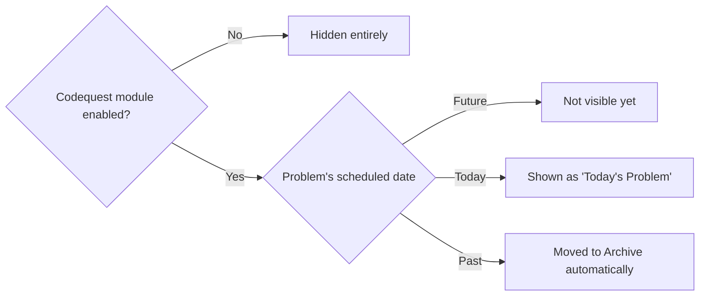
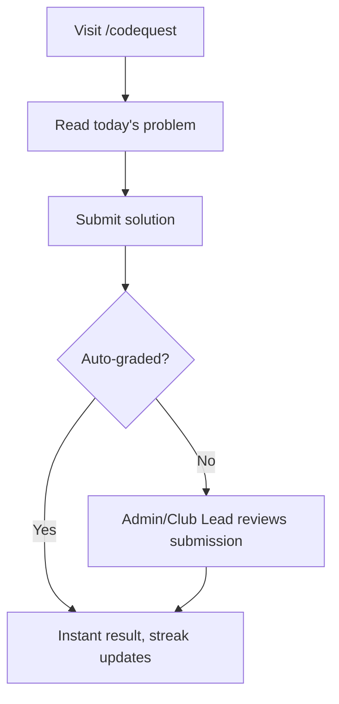

# Module: Codequest (Daily Problem of the Day)

## Overview
Codequest is the club's recurring "Problem of the Day" module (shown as **Daily Problems** in the platform's module map). A new coding problem is published automatically every day; members solve it, submit their answer/approach, and can track their streaks. It's the one module where **content publishes itself on a schedule**, rather than an admin manually posting each day.

## Who It's For
Members who want daily practice, and Admins/Club Leads who curate the problem bank.

## Public Pages

| Page | Path | What it shows | Visible to |
|---|---|---|---|
| Today's challenge | `/codequest` | Today's highlighted problem, a monthly challenge calendar (today ring, star-on-solved, monthly progress ring, future days locked), and previously published problems | Everyone |
| My statistics | `/codequest/stats` | Personal analytics & gamification dashboard (streaks, XP, badges, charts, weekly report, leaderboard) | Logged-in members |

## Admin Pages

| Page | Path | What it does | Who can access |
|---|---|---|---|
| CodeQuest workspace | `/admin/codequest` | Problems tab (upcoming/archived/all bank with per-problem submission & solved counts), Review tab (pending/all submission queue with reviewer provenance), and the persistent POTD scheduling mini-calendar | Admin, Club Lead |
| Club stats | `/admin/codequest/stats` | Club-wide stats tabbed into Overview (aggregates + activity feeds), Members (directory with per-member drill-down), Insights (streak/POTD monitoring + read-only badge catalogue), and Audit (CSV reports + the CodeQuest audit trail) | Admin, Club Lead |
| Club analytics | `/admin/codequest/analytics` | Club-wide range analytics (submissions, acceptance rate, active members, per-difficulty attempts/solves, top solvers) | Admin, Club Lead |
| Batch scheduling | `/codequest/batch-schedule` | Queue up to five complete problems in one atomic request | Admin, Club Lead |

## Implemented Features (as built)

### Content & scheduling
- **Daily auto-publishing** — only problems with `scheduled_date <= today` are public; future problems are hidden from anonymous and member callers until their date arrives.
- **Problem bank CRUD** (Admin/Club Lead) with a title-derived slug, mandatory `https://` external judge link, difficulty, points, tags, statement, and samples.
- **Single and batch scheduling** — `POST /batch-schedule/` accepts one to five entries with unique, non-past dates and saves atomically.
- **Challenge calendar & archive** — `/codequest` renders today's problem highlighted (countdown timer, topic tags), a month calendar with a today ring, a gold star on solved days, and a monthly solved-progress ring (future days locked/`aria-disabled`, navigation capped at the current month), plus previously published problems as a compact responsive grid.

### Submissions & review
- **Member submissions** (code/text, language, notes) via `POST /api/codequest/submissions/`.
- **Review workflow** — Admin/Club-Lead `POST /submissions/{id}/review/` records the verdict with reviewer provenance (`reviewed_by`/`reviewed_at`), awards XP, and rebuilds the member's streak server-side.

### Gamification (server-authoritative, `Asia/Kolkata`)
- **Coding streak** (`CodingStreak`) from active days with ≥1 submission of any verdict.
- **POTD streak** (`UserStreak`) keyed to accepted submissions on `problem.scheduled_date`.
- **XP ledger** (`XPReward`) — difficulty-based solve XP once per `(user, problem)` plus a one-time POTD bonus, idempotent via DB unique constraints.
- **Level progression** from cumulative XP (`gamification.py`).
- **Badges** — seeded `BadgeDefinition` catalog vs earned `UserBadge` rows, evaluated server-side.
- **Weekly missions** and **streak milestones** driven by configurable server thresholds.
- **Coding goals** (`CodingGoal`, GET/POST) with live progress; never affects XP, streaks, or badges.

### Statistics & analytics API
The read-only `/api/codequest/stats/` surface (`overview`, `daily`, `heatmap`,
`streak`, `potd-streak`, `xp`, `badges`, `goals`, `report`, `leaderboard`,
`analytics`) is `IsAuthenticated` and scoped to `request.user`. Each endpoint is
described in detail under [Read-only stats API](#read-only-stats-api) below.

### Member dashboard surfaces (`/codequest/stats`)
- **Key summary bar** — coding streak, POTD streak, lifetime XP + level, badges earned/total.
- **Coding activity** — full-width GitHub-style yearly heatmap (click-to-select day + year selector).
- **Progress & performance** — streak panel (with milestones), XP panel (level bar + ledger), and an analytics range filter (30/90/180 days) with daily/weekly trends, difficulty bars, XP growth, POTD trend, and the acceptance gauge.
- **Weekly report & missions** panel, plus **achievements** (badges grid) and the **club leaderboard**.
- **Unlock notifications** for level-ups, new badges, and streak milestones, deduped in `localStorage`.
- The dashboard's per-day drill-down ("Today's activity"), activity calendar, topic-performance and personal-records charts, and the goals card were removed from the UI; their endpoints remain available for future use.
- The full-width **submission heatmap** is also surfaced read-only on the member `/profile` page (deep-linking to `/codequest/stats`). It is gated by role: it is fetched and rendered only for non-privileged members, so `ADMIN`/`CLUB_LEAD` profiles never display it.

### Visibility & configuration
- **Module feature flag** hides CodeQuest entirely from the sidebar.
- **`settings.CODEQUEST_GAMIFICATION`** shallow-merges over the defaults in `gamification.py` (XP per difficulty, POTD bonus, level base, streak milestones, badge thresholds, goal targets, weekly-mission targets, leaderboard size).

## Visibility Rules (Feature Flag + Date-Based Publishing)
This module uses date-based logic differently from Events/Hackathons — instead of a whole page hiding, **individual problems publish and unpublish themselves daily**:

- Only **today's problem** (by server date) is shown on `/codequest`.
- Problems scheduled for future dates stay invisible to anonymous and member API callers until their date arrives. Admins and Club Leads can inspect the complete calendar only through the protected admin workflow.
- Once a problem's day passes, it drops out of "today" and stays viewable in the previously published challenges list on `/codequest` (and as archive entries returned by `GET /api/codequest/`).
- The entire Codequest module can still be hidden from the sidebar via the module-level feature flag (e.g. during exam season).

## Admin API workflow

The admin workspace uses the same API as the public problem feed. `POST`, `PATCH`, and
`DELETE /api/codequest/` are restricted to Admin and Club Lead users. The public `GET /api/codequest/`
response contains today's problem and the completed archive, but never future scheduled problems;
authenticated Admin and Club Lead callers receive the complete scheduling calendar. A problem carries its
scheduled date, statement, samples, tags, and a mandatory external judge link; the backend derives
its unique slug from the title.

Creating or editing a problem validates the schedule the same way the batch endpoint does:
`scheduled_date` cannot be set to a past date or to a date that already hosts another problem
(the exception is an edit that leaves an already-published problem's own date unchanged), and
`external_url` is required and must be a valid `https://` link. The admin scheduling form mirrors
these rules client-side (`min` date, inline conflict/URL errors) before the request is ever sent.

Admins and Club Leads can also create a batch through
`POST /api/codequest/batch-schedule/` using a `problems` array (one to five entries). Each
entry has the same problem content fields as the single-problem endpoint, including its own
`scheduled_date` and a required `external_url`. Dates in the batch must be unique and cannot already be assigned. The batch
is saved atomically, and public list/detail visibility still follows `scheduled_date <=
timezone.localdate()`; members cannot discover a future problem before its date.

Submissions remain member-owned. Admins and Club Leads review them through
`POST /api/codequest/submissions/{id}/review/` with `{ "is_correct": true | false }`.
The endpoint locks the submission, records the verdict along with review
provenance (`reviewed_by` + `reviewed_at`), and rebuilds the member's current and
maximum streak from distinct accepted problem dates. Verdicts and points therefore never depend
on a browser-side calculation. A submission with a null `reviewed_at` is "pending";
the serializer exposes `is_reviewed` so the admin queue can filter awaiting items
without inferring review state from the verdict alone.

Admin CodeQuest mutations are recorded in the shared audit log
(`apps/audit`) via `log_audit_event`: `codequest.problem_created`,
`codequest.problem_updated`, `codequest.problem_deleted`,
`codequest.problems_batch_scheduled`, `codequest.submission_reviewed`, and
`codequest.report_exported` (CSV downloads).

## User Flow

## Daily Stats, Streaks, XP & Achievements

Members get a per-user gamification layer derived entirely from authoritative
submission and schedule rows. Nothing here trusts the browser: streaks, XP,
levels, and badges are computed and persisted server-side in the configured
`Asia/Kolkata` timezone (`settings.TIME_ZONE`).

### Metric rules (source of truth)

- **Active coding day**: a local calendar day with at least one submission of
  any verdict. Backs the general `CodingStreak`.
- **POTD completion**: at least one accepted (`is_correct=True`) submission for
  the problem scheduled on that date. Completion is keyed to
  `problem.scheduled_date`, never the submission timestamp, and counts at most
  once per scheduled day. A late accepted submission still credits its
  scheduled day; future/unscheduled days are neither completed nor missed.
- **Unique solved**: distinct problems with at least one accepted submission.
- **XP**: awarded only by the server-side review flow and recorded in the
  immutable `XPReward` ledger — solve XP once per `(user, problem)` at first
  acceptance (difficulty-based), plus a one-time POTD bonus per scheduled date.
  Difficulty changes after a solve do not retroactively alter ledger rows; the
  awarded `difficulty`/`amount` is snapshotted.
- **Level**: cumulative-XP formula in `apps/codequest/gamification.py`
  (`level_base_xp * n` XP advances level `n → n+1`). The API returns the level
  numbers; the frontend only renders them.
- **Badges**: `BadgeDefinition` rows (seeded catalog, thresholds editable in
  admin) vs `UserBadge` rows (unique per `user + badge`). Awarded only by
  `services.evaluate_achievements`.

### Models (apps/codequest/models.py)

| Model | Purpose |
|---|---|
| `Submission` | A member's attempt at a problem. `is_correct` plus review provenance (`reviewed_by`, `reviewed_at`); a null `reviewed_at` marks it pending. |
| `CodingStreak` | General coding streak (active days), distinct from the POTD `UserStreak`. |
| `XPReward` | Immutable XP ledger with a difficulty snapshot and unique constraints for idempotent awards. |
| `BadgeDefinition` | Configurable badge catalog, separate from earned rows. |
| `UserBadge` | Earned achievement; unique `(user, badge)` with an `earned_at` timestamp. |
| `CodingGoal` | Per-user daily/weekly targets (distinct problems solved). Optional — a missing row falls back to the configured defaults. Goal progress never affects XP, streaks, or badges. |

Concurrency safety comes from `transaction.atomic()` + `select_for_update()`
plus DB `UniqueConstraint`s (`codequest_uniq_solve_xp_per_user_problem`,
`codequest_uniq_potd_bonus_per_user_day`, `codequest_uniq_user_badge`), so
duplicate or concurrent reviews cannot double-award XP or badges. Indexes on
`Submission(user, is_correct)`, `Submission(user, created_at)`, and
`XPReward(user, created_at)` back the daily/heatmap scans.

### Read-only stats API

All routes live under `/api/codequest/stats/` and are `IsAuthenticated`,
scoped to `request.user` with no user-id path parameter — a member can never
read another member's stats or reward history.

| Endpoint | Returns |
|---|---|
| `overview/` | Streak + POTD streak headline, XP/level, badge counts, today snapshot, recent unlocks. |
| `daily/?date=YYYY-MM-DD` | Totals, accepted/rejected, unique attempted/solved, difficulty breakdown, POTD status, XP earned, streak-maintained flag, submission history. |
| `heatmap/?year=YYYY` | Per-day `{submissions, accepted, solved, xp, active, potd_scheduled, potd_completed, intensity}` plus totals, most-active day, and intensity legend. |
| `streak/` | Current/longest streak, total active days, next milestone, 14-day history. |
| `potd-streak/` | Current/longest POTD streak, completion vs. eligible, recent POTD history. |
| `xp/` | Lifetime/today/week/month XP, breakdown by reward type, ledger page, level progress. |
| `badges/` | Definitions grouped by category with earned flag, progress, and earned date. |
| `goals/` (GET/POST) | Daily/weekly goal targets with live progress. `GET` returns effective goals (defaults when unset); `POST {daily_problems, weekly_problems}` (1–100 each) persists member overrides via `CodingGoal`. |
| `report/` | Weekly report: current vs. previous week (submissions, accepted, solved, active days, POTD completed, XP), per-day series, deltas, and derived weekly missions. |
| `leaderboard/?limit=` | Club ranking by lifetime XP (default `LEADERBOARD_SIZE`, capped at 50). Exposes only public-safe aggregates — display name, club id, level, XP, solved count, coding streak — never email. Includes the caller's own rank even when outside the top list. |
| `analytics/?start=&end=` | Difficulty breakdown, daily/weekly/monthly trends, acceptance rate, cumulative XP growth, POTD series, topic performance, records. |

Date ranges and query params are validated (future daily dates, out-of-range
years, `limit`/goal values, and analytics windows over `MAX_ANALYTICS_DAYS`
return `400`).

### Club-wide admin overview

`GET /api/codequest/stats/admin-overview/?days=30` is the one stats route that
aggregates across **every** member, so it is gated by `IsAdminOrClubLead`
(403 for members). `days` defaults to 30 and is clamped to 7–365. The aggregate
logic lives in `apps/codequest/admin_stats_services.py` (kept separate from the
per-user `stats_services.py`) and reuses the same POTD definition as the member
API. The response contains:

- `totals` — problems (total/published/upcoming), participants, submissions
  (total/pending/accepted), acceptance rate, lifetime XP awarded, POTD
  completions, and active coding streaks.
- `range_totals` + `daily[]` — submissions, accepted, active members, and POTD
  completions bucketed per day over the window.
- `by_difficulty` — problem counts and distinct solves per difficulty.
- `xp_distribution[]` — members per level.
- `recent_submissions`, `recent_problems`, and a `pending_queue` (unreviewed
  submissions) for the dashboard's activity feeds.

The admin frontend renders this through `CodeQuestOverview` on the separate
`/admin/codequest/stats` route (Overview tab); it never computes these numbers
client-side.

### Admin operations API (club-wide, `IsAdminOrClubLead`)

The remaining admin actions also live under `/api/codequest/stats/` and return
`403` for members. All aggregation stays in `admin_stats_services.py`:

| Endpoint | Returns |
|---|---|
| `admin-members/?q=&sort=` | Participant directory. `q` filters name/email/club ID; `sort` ∈ `xp` (default), `solved`, `streak`, `recent`, `name`. Each row: level, lifetime XP, solved, submissions, current/longest streak, POTD completed, badges earned, last active. |
| `<user_id>/member/?days=90` | One member's `overview` (reuses `stats_services.get_overview`) plus 90-day `analytics` (`get_analytics`). `404` for unknown ids. |
| `admin-analytics/?start=&end=` | Club-wide range analytics: submissions, accepted, acceptance rate, unique solved, active vs. previous-period members, POTD scheduled/completed, daily/weekly/monthly series, per-difficulty attempts/solves, top solvers. Range is validated (start ≤ end, ≤ 366 days). |
| `admin-streaks/` | Coding and POTD streak distributions and leaders, members whose live streak is at risk (not active today), today's POTD snapshot, and a 14-day POTD history. |
| `admin-gamification/` | Badge catalogue with earned counts plus the active scoring config. Read-only — XP and badges are only ever written by the server review flow. |
| `admin-export/?dataset=` | Streams a CSV attachment for `members`, `submissions`, `problems`, or `analytics`. Extra query params are forwarded as filters (`submissions` → `verdict` ∈ `all`/`pending`/`accepted`/`rejected`; `problems` → `scope` ∈ `all`/`upcoming`/`archived`; `members` → `q`; `analytics` → `start`/`end`). Unknown dataset/verdict/scope → `400`. |

### CSV reports & audit trail

Report rows are assembled in `apps/codequest/exports.py`, kept apart from the
aggregation services so the view stays a thin HTTP boundary. Each builder returns
`(headers, rows)`, so an empty dataset still emits its header row. Responses use
`text/csv; charset=utf-8` with a `utf-8-sig` BOM (Excel-friendly) and an
`attachment` filename. Downloading a report is itself audited
(`codequest.report_exported`) because it discloses member-level data.

The admin UI surfaces these reports alongside the audit trail: the shared
read-only `GET /api/audit/` endpoint (see `apps/audit`) accepts additive,
optional filters — `action`, `action_prefix`, `target_model`, `target_id`,
`actor`, `q`, and `limit` — so the console scopes the trail with
`action_prefix=codequest.` without a CodeQuest-specific endpoint.

### Problem submission counts

`ProblemViewSet.get_queryset` annotates each problem with `submissions_count`
and `solved_count` (distinct accepted users); `ProblemSerializer` exposes both
as read-only integers (default `0`). This powers the admin problem list, the
scheduling calendar, and the member `ProblemCard` "solved by" count without an
N+1 query.

### Configuration

`apps/codequest/gamification.py` holds the configurable defaults (XP per
difficulty, POTD bonus, level base, streak milestones, badge thresholds,
default goal targets, weekly-mission targets, and leaderboard size).
Deployments override any key via `settings.CODEQUEST_GAMIFICATION`, which is
shallow-merged over the defaults.

---

## Key Features Used
- [Scheduling](../features/scheduling.md) — the core mechanic of this module; auto-publish/unpublish by date
- [Feature Flags](../features/feature-flags.md) — module-level hide/show
- [Analytics & Insights](../features/analytics-insights.md) — leaderboard, streaks, engagement
- [Data Export](../features/data-export.md) — exporting submission data

## Data Captured
Problem metadata (difficulty, tags), member submissions (code/text, timestamp, correctness), streak counters.

## Roles Involved
Member (solver), Club Lead/Admin (problem curator and submission reviewer — the review action is `IsAdminOrClubLead`; there is no Volunteer review path).

## Related Docs
- [../features/scheduling.md](../features/scheduling.md)
- [../admin/content-management.md](../admin/content-management.md)
