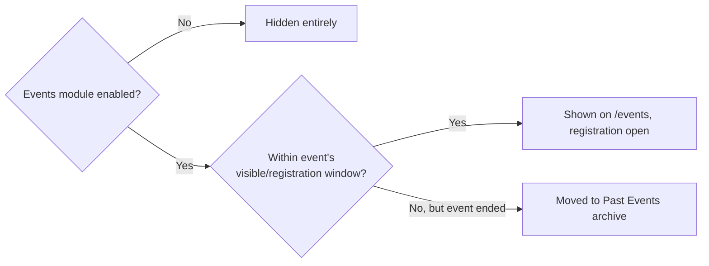
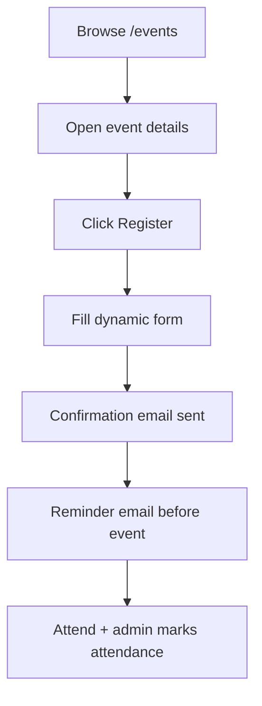

# Module: Events

## Overview
The Events module covers everything that *isn't* a hackathon — workshops, seminars, guest talks, meetups, coding contests, orientation sessions. It's the general-purpose "something is happening, come register" engine for the club.

## Who It's For
Members who want to attend, and Club Leads/Admins who organize.

## Public Pages

| Page | Path (example) | What it shows | Visible to |
|---|---|---|---|
| Events listing | `/events` | All events (no server-side date filtering — `EventViewSet` returns `Event.objects.all()` unfiltered; see the Visibility Rules gap note below), filterable by category | Everyone |
| Event details | `/events/[slug]` | Description, date/time/venue (or online link), speaker info, registration button | Everyone |
| Registration form | `/events/[slug]/register` | Dynamic form (varies per event — could be as simple as name+email, or detailed) | Logged-in members (or public, if event is open) |
| My registrations | `/events/my` | List of events a member has registered for, with reminders | Logged-in members |

## Admin Pages

| Page | Path (example) | What it does | Who can access |
|---|---|---|---|
| Event manager | `/admin/events` | Create/edit events: title, date/time, venue, capacity, visibility window | Admin, Club Lead |
| Registration form builder | `/admin/events/[slug]/form` | Build the registration form via [Dynamic Form Builder](../features/dynamic-form-builder.md) | Admin, Club Lead |
| Attendee list | `/admin/events/[slug]/attendees` | View/export registrants, mark attendance, send reminders | Admin, Club Lead, Volunteer |

## Visibility Rules (Feature Flag + Event Dates)
1. **Module-level flag** can hide "Events" from the sidebar entirely — this part is real (see [Feature Flags](../features/feature-flags.md)).
2. **Per-event date window — not implemented.** `Event` does have `visible_from`/`visible_until` columns and they're editable via the API, but `EventViewSet.get_queryset()` (`apps/events/views.py`) is just `Event.objects.all()` — no date filtering at all. A past event does not automatically drop off `/events`; nothing currently archives it server-side. See [Scheduling](../features/scheduling.md) for the full per-item breakdown across modules.

## User Flow

## One-Click Registration
When an admin creates or edits an event they choose how members register:

- **Custom form**: link a form built in the Form Builder (as before).
- **One-click**: tick which member details to collect (name and email are always included; phone, branch, roll number, college, year and Club ID are optional). No form to build.

How it works (`apps/events/quick_registration.py`): saving an event with `quick_registration_fields` creates (or updates) a normal published form made only of profile-bound fields and links it as the event's `registration_form`. The server fills every answer from the signed-in member's own profile (`FormField.profile_field`), so responses, exports, confirmation emails, attendance badges and duplicate prevention all work unchanged.

- The event's `capacity` becomes the form's `max_total_responses`, so registration closes by itself when the event is full. Renaming the event or changing its capacity keeps the form in step.
- A form counts as one-click when every active field is profile-bound. Adding an ordinary question to it in the Form Builder turns it into a custom form. The event API reports this as `is_quick_registration` and `registration_profile_fields`.
- Switching an event from a custom form to one-click creates a new form; the custom form and its responses are never modified.
- On the public pages a signed-in member registers with one click (`QuickRegisterButton` in the frontend). A signed-out visitor is sent to login and back. A member whose profile lacks a chosen detail is told which one and linked to their profile. Registering needs a signed-in account.

## Event Reminders
`manage.py send_event_reminders` (run **hourly from cron**, like `send_hackathon_reminders`) reminds registered members a day and an hour before an event starts (`apps/events/reminders.py`).

- **Who:** members with a non-test registration response on the event's form, active accounts only. Someone who registered after a reminder's moment is not sent that reminder.
- **Where:** always in the notification bell (category `EVENT`, links to the event); also by email unless the member turned event reminder emails off (`NotificationPreference.event_reminder_emails`, `GET/PATCH /api/notifications/preferences/`).
- **Once only:** each reminder is recorded in `EventReminder` (unique per event, person and lead) before it is sent, so re-running or running twice at once never duplicates it. A cancelled registration is no longer found, so it gets nothing. Events with no start time or no registration form are ignored.
- **If the cron is late:** a run after the one-hour mark but before the start still sends both reminders in one go; after the start nothing is sent.

## Cancelling a Registration
`DELETE /api/events/{slug}/my-registration/` lets a signed-in member cancel their own registration (`apps/events/registration.py`).

- **Allowed** until the event's `start_time` (an event with no date can still be cancelled) and only while the person has not been scanned in.
- **Blocked** with `409`: `EVENT_STARTED` or `ALREADY_ATTENDED`. `404` `NOT_REGISTERED` when there is nothing to cancel. Preview submissions are never touched.
- **What happens:** the registration response is deleted (its uploads are released by the existing `pre_delete` signal), so the seat count drops and the one-response-per-person rule lets the person register again. If the event had filled up, its form had closed itself, so the form is published again (`apps/events/capacity.py`, `reopen_if_room`): only a form that was full before the change, and whose own closing time has not passed, is reopened; one an organizer closed on purpose stays closed. Raising an event's capacity does the same for a one-click event. A `Cancelled Event Registration` audit entry records who and which event, because the response itself is gone.
- The profile's registered-event items carry `event_started` so the frontend only offers the button before the start.
- **Organizer control (`Event.cancellation_locked`, `Event.cancellation_cutoff_hours`).** Locked: members cannot cancel on their own (`409 CANCELLATION_LOCKED`); organizers can still remove a registration from the admin side. Cutoff: cancelling stops that many hours before `start_time` (`0` = until the start; `409 CANCELLATION_CLOSED` after). `EVENT_STARTED` always wins, an event with no date has no cutoff, and the cutoff may be 0 to 720 hours. Both fields are in the event API (public read, admin write) and the profile's `registered_events[].cancellation` carries `{allowed, reason, closes_at}` so the ticket can show "You can cancel until ..." or why the button is gone. Existing events keep today's behaviour (allowed, until the start).

## Post-Event Feedback
Attendees rate an event once it is over. The rules live in `apps/events/feedback.py`; the model is `EventFeedback` (one row per person per event).

| Endpoint | Who | What it does |
|---|---|---|
| `GET /api/events/{slug}/feedback/` | Any signed-in member | Returns `eligible`, `reason` (`EVENT_NOT_ENDED` or `NOT_ATTENDED`) and the caller's own feedback. |
| `PUT /api/events/{slug}/feedback/` | Eligible member | Creates (201) or changes (200) their feedback: `rating` 1-5, `would_recommend`, optional `went_well` and `to_improve` (500 characters each). |
| `GET /api/events/{slug}/feedback/summary/` | Admin, Club Lead | Count, average, 1-5 spread, recommend rate, attendees, response rate and the written answers (newest 100). |
| `GET /api/events/{slug}/feedback/export/?export_format=csv\|xlsx\|json` | Admin, Club Lead | One row per answer, formula-safe, audited. |

- **Who may leave it:** only a person with an `AttendanceRecord` on their own non-test registration for the event, and only after the event ended (`end_time`, or one hour after `start_time` when no end is set). An event with no date never opens.
- **Hidden events:** the member endpoint looks the event up outside the public visibility window, so attendees can still rate an event that was hidden after it ended.
- **Attendance must be on:** an event whose form does not scan attendance cannot collect feedback.

## Attendance Certificates
Any event can issue a certificate to the people who were checked in. Code: `apps/events/certificates.py`; settings live on `Event` (`certificates_released`, `certificate_body`, `certificate_signatory_name`, `certificate_signatory_title`).

| Endpoint | Who | What it does |
|---|---|---|
| `GET /api/events/{slug}/my-certificate/` | Signed-in member | Their certificate (name, wording, date, signatory, `code`). `403` with code `NOT_RELEASED` until an organizer releases certificates, or `NOT_ELIGIBLE` when they were not checked in. |
| `GET/PUT /api/events/{slug}/certificates/` | Admin, Club Lead | Release switch, wording (`{name}` and `{event}` only), signatory, `eligible_count` and a `preview`. |
| `GET /api/events/certificates/verify/{code}/` | Public | `valid`, name, event and date for a genuine code; `404` otherwise. |

- **Nothing is stored per person.** The code is a signed (event, person) pair, prefixed `ev.` so the public verify page can tell it from a hackathon code. It cannot be forged.
- **Who is eligible:** the same rule as feedback, a scanned `AttendanceRecord` on the person's own registration. There is no automatic release; an organizer turns certificates on per event.

## Key Features Used
- [Dynamic Form Builder](../features/dynamic-form-builder.md)
- [Feature Flags](../features/feature-flags.md) — module + date-based visibility
- [Scheduling](../features/scheduling.md) — auto-archive past events, reminder timing
- [Custom Email & Notifications](../features/email-notifications.md) — confirmations, reminders
- [Data Export](../features/data-export.md) — attendee lists for check-in
- [Analytics & Insights](../features/analytics-insights.md) — attendance/engagement stats

## Data Captured
Attendee name, contact, college/branch/year (or custom fields per event), attendance status.

## Roles Involved
Member (attendee), Club Lead/Admin (organizer), Volunteer (check-in support).

## Related Docs
- [../admin/event-hackathon-management.md](../admin/event-hackathon-management.md)
- [hackathon.md](hackathon.md) — for hackathon-specific events, use that module instead
